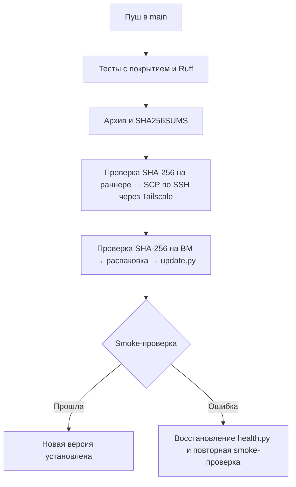

# Linux Health Checker

[](https://github.com/PREEMRU/linux-health-checker/actions/workflows/ci.yaml?query=branch%3Amain)

Linux Health Checker выводит загрузку CPU, использование RAM и корневого раздела `/`, а также состояние службы `ssh`. Таймер systemd запускает проверку, а отчёт попадает в journal. GitHub Actions запускает тесты и линтер, а после успешных проверок в `main` доставляет обновление на ВМ и проверяет его через smoke-сервис.

## Быстрый старт на Ubuntu

Нужна ВМ на Ubuntu с systemd, системным Python 3.10 или новее и пользователем с доступом к `sudo`. Для состояния `SSH: ACTIVE` служба `ssh.service` должна быть активна.

На ВМ выполните команды под своим пользователем с доступом к `sudo`.

```bash
sudo apt update
sudo apt install -y git python3
git clone https://github.com/PREEMRU/linux-health-checker.git
cd linux-health-checker
sudo bash deploy/install.sh
```

Скрипт [install.sh](deploy/install.sh) создаёт системного пользователя `health-checker`, если его ещё нет, и устанавливает `health.py` в `/opt/linux-health-checker/`. Он копирует обычный сервис и таймер в `/etc/systemd/system/`, перечитывает конфигурацию systemd и включает таймер сразу. Таймер настроен на первый запуск через минуту после загрузки и дальнейшие запуски через пять минут после завершения сервиса.

Проверьте таймер и журнал. Команда `systemctl start` позволяет получить отчёт сразу.

```bash
systemctl list-timers --all linux-health-checker.timer
sudo systemctl start linux-health-checker.service
sudo journalctl -u linux-health-checker.service -b -n 30 --no-pager -o cat
```

Пример формата отчёта в журнале.

```text
=== SERVER HEALTH REPORT ===
    CPU:    2.41% [OK]
    RAM:    28.63% [OK]
    Disk:   17.42% [OK]
    SSH:    ACTIVE
```

## Локальная разработка

Для разработки нужны Linux, `make`, `uv` и Python 3.14 или новее по [pyproject.toml](pyproject.toml). Выполняйте команды из корня репозитория.

```bash
uv sync --locked
uv run health.py --warning 80 --critical 90
make test
make coverage
make lint
```

`make test` запускает pytest, `make coverage` требует как минимум 90% покрытия `health.py`, а `make lint` запускает Ruff. Тесты проверяют расчёт метрик, пороги и запись отчёта, а также замену файла обновлятором и поведение при ошибке копирования.

## Как устроен деплой

Workflow [CI](.github/workflows/ci.yaml) запускается при пуше. Задача деплоя выполняется только в `main` после успешного завершения задачи проверок.



После сборки CI записывает SHA-256 архива `linux-health-checker.tar.gz` в `SHA256SUMS`. Задача деплоя сверяет сумму на раннере перед отправкой и на ВМ перед распаковкой. Раннер подключается к Tailscale, проверяет ключ SSH-хоста по `known_hosts` и передаёт оба файла через SCP во временный каталог пользователя `deploy`.

[update.py](deploy/update.py) сохраняет предыдущий `health.py` во временную резервную копию. Затем он записывает новый файл рядом с установленным и атомарно заменяет его через `Path.replace()`. [Smoke-скрипт](deploy/smoke_check.sh) читает journal до и после запуска smoke-сервиса, а [валидатор](deploy/check_smoke_report.py) ищет ровно один новый запуск и проверяет заголовок и поля `CPU:`, `RAM:`, `Disk:` и `SSH:`. Если smoke-проверка падает, обновлятор восстанавливает файл из копии и повторяет проверку.

### Подготовка ВМ для CI/CD

После быстрого старта администратор вручную создаёт пользователя `deploy`, настраивает доступ по SSH через Tailscale и добавляет публичный ключ CI в `~deploy/.ssh/authorized_keys`. На ВМ каталог `/opt/linux-health-checker` должен быть доступен `deploy` на запись для атомарной замены файла. Например, на тестовой ВМ каталог принадлежит `root:deploy` и имеет режим `2775`.

Для smoke-проверки администратор копирует [обычный сервис](deploy/linux-health-checker.service) в отдельный юнит `/etc/systemd/system/linux-health-checker-smoke.service` и выполняет `sudo systemctl daemon-reload`. Оба юнита запускают `/opt/linux-health-checker/health.py` через `/usr/bin/python3` от пользователя `health-checker` и принимают коды выхода `1`, `2` и `3` как штатный результат отчёта. Smoke-юнит запускается по запросу из скрипта деплоя.

Через `sudo visudo -f /etc/sudoers.d/linux-health-checker` администратор разрешает `deploy` выполнять без пароля две команды из smoke-скрипта.

```sudoers
deploy ALL=(root) NOPASSWD: /usr/bin/systemctl start linux-health-checker-smoke.service
deploy ALL=(root) NOPASSWD: /usr/bin/journalctl -u linux-health-checker-smoke.service -b -n 100 -o json --no-pager
```

### Настройки GitHub Actions

| Тип | Имя | Назначение |
| --- | --- | --- |
| Переменная | `DEPLOY_HOST` | Имя или адрес ВМ, доступной через Tailscale |
| Переменная | `DEPLOY_KNOWN_HOSTS` | Запись с публичным ключом SSH-хоста для `known_hosts` |
| Секрет | `DEPLOY_SSH_KEY` | Приватный SSH-ключ для входа под `deploy` |
| Секрет | `TAILSCALE_AUTHKEY` | Ключ подключения раннера к Tailscale |

## Что я проверил на ВМ

1. **Обычный деплой.** Запустил деплой через GitHub Actions. После обновления smoke-проверка на ВМ прошла.
2. **Откат.** Отдельно запустил `update.py` вручную на `ubuntu-lab` под пользователем `deploy`. Из отчёта тестовой версии убрал строку `SSH:`. Первая smoke-проверка завершилась ошибкой `Missing report field: SSH:`. Обновлятор восстановил предыдущий `health.py`, повторная smoke-проверка прошла, а SHA-256 установленного файла совпал с исходным. Обновлятор вернул код `1`, чтобы сообщить о провале обновления.
